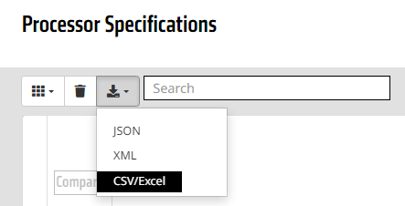

# CPU Specification Dataset

Open dataset of CPU specifications for Intel, AMD and Ampere processors as CSV files, extended by PassMark CPU benchmark
scores and CPU-World data. It covers more than 4,000 desktop, laptop and server processors (e.g. Intel Core and Xeon,
AMD Ryzen and EPYC, Ampere Altra and AmpereOne) with cores, threads, clock speeds, cache, TDP, socket and launch date,
scraped from the official manufacturer websites (Intel ARK, AMD). The data is available as CSV files, REST API and
Docker image.

## Table of Contents

* [Raw Datasets](dataset)
* [Dataset API](dataset-api/src/main/java/cpu/spec/dataset/api)
* [AMD Web Scraper](amd-web-scraper/src/main/java/cpu/spec/scraper)
* [Ampere Web Scraper](ampere-web-scraper/src/main/java/cpu/spec/scraper)
* [Intel Web Scraper](intel-web-scraper/src/main/java/cpu/spec/scraper)
* [Benchmark Web Scraper](benchmark-web-scraper/src/main/java/cpu/spec/scraper)
* [Cpuworld Web Scraper](cpuworld-web-scraper/src/main/java/cpu/spec/scraper)

## Installation

Requires __JDK 25__ & __Maven 3.6.3+__ (tested with OpenJDK 25 & Maven 3.6.3).

__Windows__:

```shell
xcopy .\dataset\ .\dataset-api\src\main\resources\dataset /s /e /h /y 
mvn clean install -DskipTests
```

__Linux__:

```shell
mkdir -p ./dataset-api/src/main/resources/dataset/ && cp ./dataset/* ./dataset-api/src/main/resources/dataset/
mvn clean install -DskipTests
```

## Dataset API Usage

```shell
cd dataset-api
mvn spring-boot:run
```

Endpoints at `http://localhost:8080` (Swagger UI at `/swagger-ui.html`):

* `GET /api/cpu-dataset/{name}`: CPU with exactly this name
* `GET /api/cpu-dataset?contains=xeon&contains=8380`: all CPUs whose name contains every condition (ignore case)

<details>
  <summary>Configurations</summary>

[dataset-api/application.properties](dataset-api/src/main/resources)

| Property                                     | Example Value                         | Description                        |
|----------------------------------------------|---------------------------------------|------------------------------------|
| `spring.datasource.url`                      | `jdbc:mysql://localhost:3306/cpu_db`  | Full url to a MySQL database       |
| `spring.datasource.username`                 | `root`                                | Username and usually root          |
| `spring.datasource.password`                 | `password`                            | Custom password                    |
| `spring.jpa.hibernate.ddl-auto`              | `update` or `validate`                | Table schema update mode           |
| `spring.jpa.defer-datasource-initialization` | `false` or `true`                     | `true` skips the dataset import    |

</details>

## Container Image

The Dataset API requires a MySQL database, e.g. as container:

```shell
docker run --name mysql -e MYSQL_ROOT_PASSWORD=password -e MYSQL_DATABASE=cpu_db -p 3306:3306 -d mysql:8
```

Published images: [ghcr.io/felixsteinke/cpu-spec-dataset-api](https://github.com/users/felixsteinke/packages/container/package/cpu-spec-dataset-api)
with one tag per release (e.g. `v2.1`) and `latest` for the newest release.

```shell
docker run -p 8080:80 --name dataset-api ghcr.io/felixsteinke/cpu-spec-dataset-api:latest
```

Local build:

```shell
docker build -t cpu-spec-dataset-api:local .
docker run -p 8080:80 --name dataset-api cpu-spec-dataset-api:local
```

### Container Configuration

| Environment Key                              | Example Value                                   | Description                         |
|----------------------------------------------|-------------------------------------------------|-------------------------------------|
| `SPRING_DATASOURCE_URL`                      | `jdbc:mysql://host.docker.internal:3306/cpu_db` | Full url to a MySQL database        |
| `SPRING_DATASOURCE_USERNAME`                 | `root`                                          | Username and usually root           |
| `SPRING_DATASOURCE_PASSWORD`                 | `password`                                      | Custom password                     |
| `SPRING_JPA_HIBERNATE_DDL_AUTO`              | `validate` (default) or `update`                | Table schema update mode            |
| `SPRING_JPA_DEFER_DATASOURCE_INITIALIZATION` | `false` (default) or `true`                     | `true` skips the dataset import     |

> __Dataset import:__ by default every start imports all datasets of the image into the database (existing rows are
> updated, new ones added, none deleted), which takes a few seconds before the data is complete. With
> `SPRING_JPA_DEFER_DATASOURCE_INITIALIZATION=true` the import is skipped and the API serves the database as it is,
> e.g. for faster restarts of an already filled database. A new image version only provides its datasets through the
> import, so do not skip it on the first start of a new version.

> __Upgrading an existing database:__ the `prod` profile only validates the schema (`ddl-auto=validate`) and fails to
> start with `missing column [...]` if the table was created by an older version (e.g. `v1.0` lacks the `*_index`
> columns). Start the new version once with `SPRING_JPA_HIBERNATE_DDL_AUTO=update` to add the missing columns, then
> use the default configuration again. Existing rows are kept and updated by the dataset import.

## Release

Versions follow `vMAJOR.MINOR` (e.g. `v2.1`): __MAJOR__ for recreated datasets or breaking API changes, __MINOR__ for
updates and fixes. The Maven project version (all `pom.xml` files) matches the release version.

1. Update the version in all `pom.xml` files (e.g. `2.1`) and merge to `main`.
2. Publish a [GitHub Release](https://github.com/felixsteinke/cpu-spec-dataset/releases/new) with the tag `v2.1`.
3. The [Docker-Image workflow](.github/workflows/docker-image.yml) builds the image and pushes the tags `v2.1`
   and `latest` (pre-releases only get their version tag). The workflow fails before building if the release tag
   does not match `v` + the version of all `pom.xml` files, or if the image `v2.1` already exists (published versions
   are never overwritten).

## Datasets

> __Previous datasets:__ the datasets are only kept in their latest version, older versions are in the git history
> (e.g. CPUs that were removed from the manufacturer websites).

### [AMD Dataset](dataset/amd-cpus.csv)

Extracted from the specification tables (client and server processors) of
[https://www.amd.com/en/products/specifications/processors.html](https://www.amd.com/en/products/specifications/processors.html)
with the [AMD Web Scraper](amd-web-scraper/src/main/java/cpu/spec/scraper). The pages embed the same data the
__Export__ button of the table uses (1 request per page, a few seconds).

<details>
  <summary>Manual Export (fallback)</summary>



</details>

### [Ampere Dataset](dataset/ampere-cpus.csv)

Extracted from the SKU tables of the product briefs
([Ampere Altra](https://amperecomputing.com/briefs/ampere-altra-family-product-brief),
[AmpereOne](https://amperecomputing.com/briefs/ampereone-family-product-brief),
[AmpereOne M](https://amperecomputing.com/briefs/ampereone-m-product-brief))
with the [Ampere Web Scraper](ampere-web-scraper/src/main/java/cpu/spec/scraper).

### [Intel Dataset](dataset/intel-cpus.csv)

Extracted from
[https://www.intel.com/content/www/us/en/ark.html](https://www.intel.com/content/www/us/en/ark.html)
with the [Intel Web Scraper](intel-web-scraper/src/main/java/cpu/spec/scraper) (about 3,000 specification pages, run a
smoke test with `-Dscraper.limit=5` first).

### [CPU Benchmark Dataset](dataset/benchmark-cpus.csv)

Extracted from the data table of [https://www.cpubenchmark.net/CPU_mega_page.html](https://www.cpubenchmark.net/CPU_mega_page.html)
(all CPUs with specifications and benchmark scores, 1 page load) with the
[Benchmark Web Scraper](benchmark-web-scraper/src/main/java/cpu/spec/scraper) (Chrome).

### [CPU World Dataset](dataset/cpuworld-cpus.csv)

> __Frozen dataset:__ cpu-world denies automated requests (HTTP 403 for bots, data center IP ranges and the scraping
> of its content), so the dataset of July 2023 (243 Intel Xeon Platinum & Gold CPUs) is kept as it is. The scraper is
> excluded from the default runs of `scripts/scrape-all.sh` and the workflows and only runs if it is listed explicitly.

Extracted from [https://www.cpu-world.com/CPUs/CPU.html](https://www.cpu-world.com/CPUs/CPU.html)
(Intel Xeon Platinum & Gold, waits 3 - 10 s between pages) with the
[CPU World Web Scraper](cpuworld-web-scraper/src/main/java/cpu/spec/scraper) (Chrome).

### Recreate all Datasets

Requires __JDK 25__, __Maven__ and __Google Chrome__ (benchmark & cpu-world scraper, the driver is resolved
automatically by Selenium) and runs on Linux, macOS and Windows (Git Bash):

```shell
./scripts/scrape-all.sh                 # default scrapers: amd ampere benchmark intel
./scripts/scrape-all.sh amd benchmark   # selected scrapers
```

The script builds the project, runs the scrapers (logs in `logs/`), validates the datasets with the Dataset API
tests and prints a summary. It exits with `1` if the build or the validation failed and with `2` if a scraper failed
(the other datasets are valid). Review the result with `git diff --stat dataset/` before committing it.

A single scraper runs on its own after the build, the JVM options below go before `-jar`:

```shell
cd intel-web-scraper   # or amd-, ampere-, benchmark-, cpuworld-web-scraper
java -jar ./target/executable.jar
```

| JVM Option (`JAVA_OPTS="..."`) | Description                                                                     |
|--------------------------------|---------------------------------------------------------------------------------|
| `-Dscraper.limit=5`            | Smoke test with the first 5 pages per level, written to `dataset/*.limited.csv` |
| `-Dscraper.delay=500`          | Wait 500 ms between detail page requests (Intel)                                |
| `-Dscraper.force=true`         | Replace the dataset instead of merging the scraped records into it              |

Safeguards:

* __Merge by default:__ the scraped records are merged into the dataset. CPUs of the dataset are updated, new CPUs are
  appended and CPUs the run did not find (removed from the website or blocked requests) keep their row, so no id of the
  Dataset API disappears. A CPU is identified by its name and, if the dataset has one, its `CpuId`.
* __Stable API:__ the CPU name is the id of the Dataset API. The scrapers keep the names, columns and value formats of
  the previous dataset version, new columns are appended (benchmark: CPUs keep their previous name and values the
  source does not provide anymore).
* The Intel scraper stops after 25 failed specification pages in a row (requests blocked).

All updates to the datasets need to be carefully reviewed. The columns are mapped by their __header name__ in the
corresponding [Dataset Class](dataset-api/src/main/java/cpu/spec/dataset/api/dataset) for the __Dataset API__.
If a regenerated dataset renames or drops a mapped column, the dataset tests fail (`scrape-all.sh` runs them):

```shell
cd dataset-api
mvn test -Dtest="CsvMapperTest,*DatasetTest"
```

To merge a records file into its dataset manually, see [scripts/merge-dataset.sh](scripts/merge-dataset.sh).
